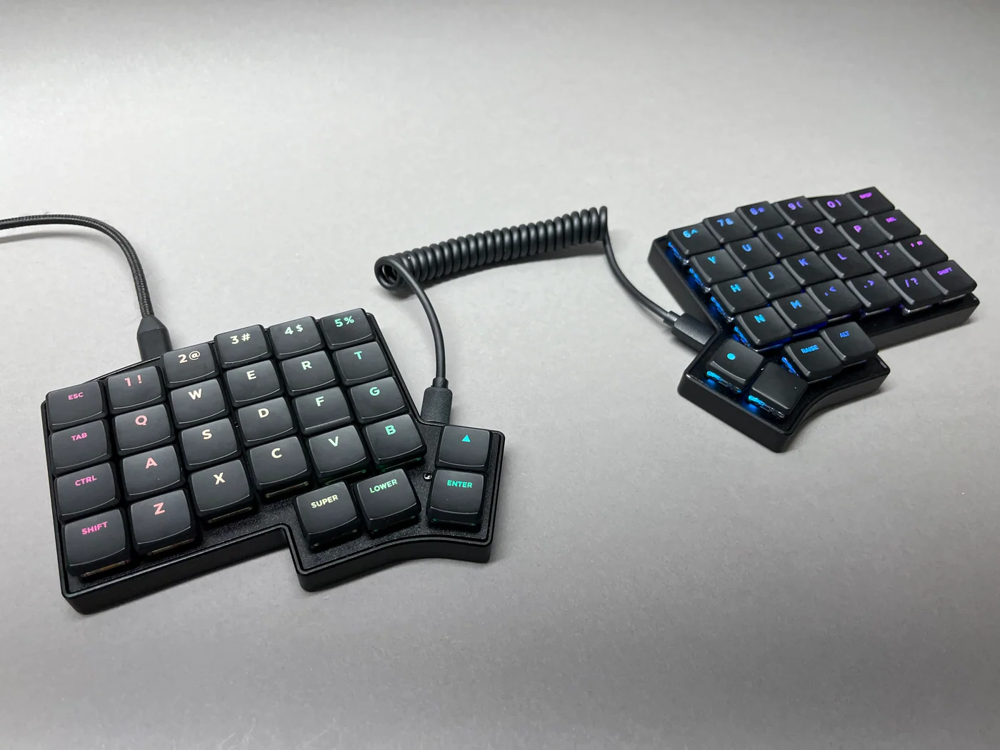
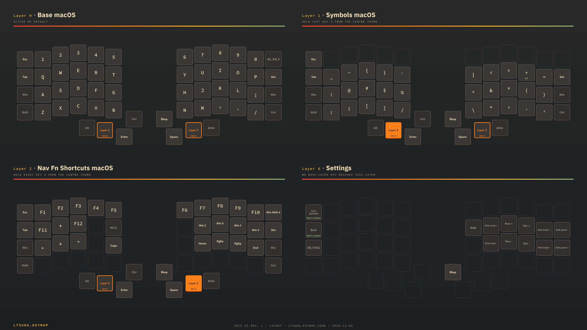
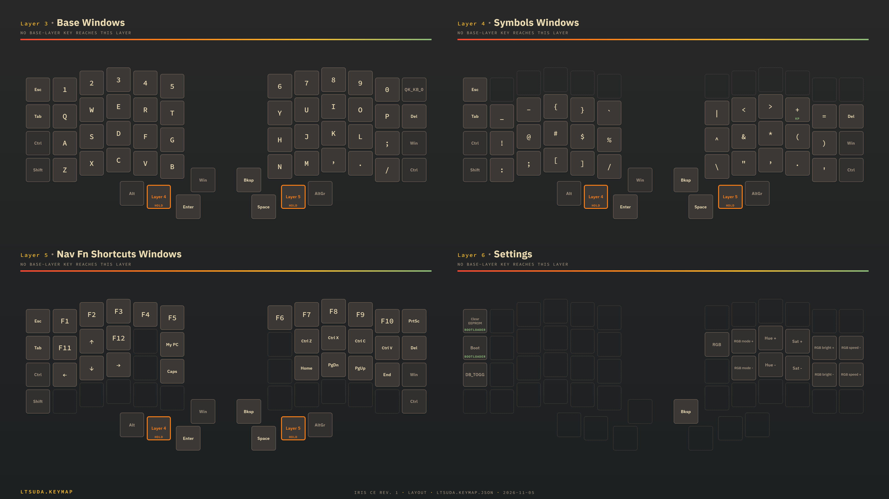

# ltsuda firmware (Keebio Iris CE Rev.1)

External QMK userspace repository containing the `ltsuda` keymap for the
[Keebio Iris CE Rev.1 kit](https://keeb.io/products/iris-ce-kit). It works with QMK's
`user.overlay_dir`; no QMK source lives in this repo.

[](https://keeb.io/products/iris-ce-kit)

Example Iris CE build. Click the photo for the kit page.

## Keymap

The layer pictures below show the macOS and Windows variants. Click either one for the
full-size PNG.

| macOS | Windows |
| --- | --- |
| [](assets/keymap-macos.png) | [](assets/keymap-windows.png) |

Both pictures come from `ltsuda.keymap.json` and were rendered with
[Keymap Image Generator](https://whitehatnetizen.github.io/keymap-imgen/)
([source](https://github.com/whitehatnetizen/keymap-imgen)).

## Repository layout

```
keyboards/keebio/iris_ce/rev1/keymaps/ltsuda/
    keymap.c     # the keymap (see below)
    rules.mk     # TRI_LAYER_ENABLE = yes
    config.h     # factory default RGB effect (ALPHAS_MODS)
assets/
    keyboard.png
    keymap-macos.png
    keymap-windows.png
ltsuda.keymap.json   # c2json export for the layer pictures (not a build source)
qmk.json             # userspace build descriptor (build/flash targets)
```

The keyboard definition is stock upstream QMK and is not copied here.

## What the keymap does

Boots into Windows. The top-right key toggles to macOS and back. The choice is
per-session and does not survive a reboot.

- Symbols and Nav layers exist in both OS variants, each with that OS's modifier order.
- Hold both FN keys to enter Settings; release either key to exit.
- The RGB indicator shows the active OS stack: blue for Windows, red for macOS, magenta for
  Settings. The effect is fixed to ALPHAS_MODS (static colours). You can change it in
  Settings, but it reverts at the next boot.
- Backspace lives above Space. The top-right key on the base layers is the OS toggle
  only; Esc stays Esc on both.

## Prerequisites

- QMK CLI installed; `qmk doctor` passes.
- QMK Firmware cloned once (`qmk setup`).
- This repo cloned somewhere, for example `~/developer/keyboards`.

## Setup (once per machine)

```bash
cd ~/developer/keyboards
# git pull if you already have it, clone first otherwise
qmk config user.overlay_dir="$(realpath ~/developer/keyboards)"
```

## Build

Every target listed in `qmk.json`:

```bash
cd ~/developer/keyboards
qmk userspace-compile
```

Or just this one target (same output; the UF2 is also copied to the repo root):

```bash
qmk compile -kb keebio/iris_ce/rev1 -km ltsuda
```

## Flash

The Iris CE is RP2040-based, so the bootloader is UF2. Each half is flashed separately,
with the same file. The interconnect cable does not matter for flashing.

1. Put the half into bootloader mode. Double-tap the Reset button (between the halves),
   or hold it for at least one second and release.
2. Wait for the OS to detect the board. It appears as a USB mass-storage drive named
   `RPI-RP2`.
3. Copy `keebio_iris_ce_rev1_ltsuda.uf2` to the `RPI-RP2` drive. The drive ejects itself
   and the half reboots into the new firmware.
4. Repeat with the other half.

Both halves use the same .uf2. Flash both when anything in the shared protocol may have
changed. For keymap-only edits, you only need to reflash the half the USB cable plugs into.
When in doubt, flash both.

You can also drive it from the command line:

```bash
qmk flash -kb keebio/iris_ce/rev1 -km ltsuda
```

It waits for you to enter bootloader mode; use one of the two methods above.

## Notes

- Not VIA-compatible by design (7 layers, custom keycodes).
- Iterating: edit `keymap.c`, rebuild, reflash.
